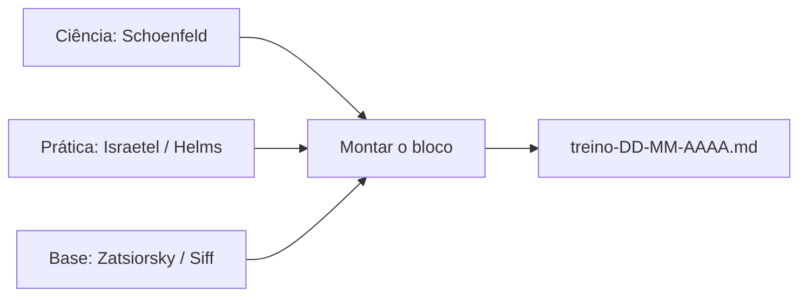

## Resumo Didático

**O que é:** Pesquisa dos livros mais bem avaliados para montar treinos de hipertrofia (ganho de massa muscular) em nível avançado, para apoiar as periodizações da Karla.

**Como funciona:**
- Cruzei notas do Goodreads (nota média de 1 a 5 dada por leitores), listas de especialistas e discussões de comunidade (Reddit).
- Separei os livros em 3 papéis: "teoria + ciência", "montar o programa na prática" e "base clássica de periodização".
- Nota alta com poucas avaliações vale menos que nota boa com muitas avaliações; indiquei a quantidade ao lado.

**Diagrama:**

**Por que assim:** Um livro só não cobre tudo. A combinação "Schoenfeld (por quê) + Israetel ou Helms (como)" é o consenso mais repetido entre fontes. Descartei livros de iniciante (Starting Strength, Bigger Leaner Stronger) por não atenderem o nível avançado.

---

# Melhores livros para treinos de hipertrofia avançados

Data: 2026-11-02 | Profundidade: standard | Confiança geral: média-alta

## Resumo executivo

Três livros aparecem de forma consistente no topo para nível avançado: **Science and Development of Muscle Hypertrophy** (Schoenfeld), **Scientific Principles of Hypertrophy Training** (Israetel/RP) e **The Muscle and Strength Pyramid: Training** (Helms). Os dois últimos trazem programas prontos para adaptar. Para base teórica de periodização, os clássicos são Zatsiorsky e Siff.

## Ranking

| # | Livro | Autor | Nota Goodreads | Papel |
|---|---|---|---|---|
| 1 | Science and Development of Muscle Hypertrophy (2a ed., 2020) | Brad Schoenfeld | 4,40 (284 av.) a 4,43 (399 av., todas as edições) | Referência científica; capítulo 8 monta programas; 1.000+ referências |
| 2 | Scientific Principles of Hypertrophy Training (RP) | Mike Israetel et al. | 4,51 (518 av.) | Volume, intensidade, frequência, fadiga, deload, seleção de exercícios |
| 3 | The Muscle and Strength Pyramid: Training | Eric Helms et al. | 4,5 a 4,56 (centenas de av.; autor: 4,50 em 1.592) | 6 programas (novato a avançado) para adaptar |
| 4 | The Muscle Ladder | Jeff Nippard | 4,50 (só 83 av.) | Guia único, mais acessível; menos profundo |
| 5 | Science and Practice of Strength Training | Zatsiorsky / Kraemer | 4,30 (465 av.) | Base de periodização e carga (mais força que hipertrofia) |
| 6 | Supertraining | Mel Siff | 4,46 (306 av.) | Referência técnica avançada; densa |
| 7 | Designing Resistance Training Programs | Fleck / Kraemer | não verificada | Clássico de prescrição de variáveis |
| 8 | The New Encyclopedia of Modern Bodybuilding | Schwarzenegger | não verificada | Catálogo de exercícios e história; pouca ciência atual |

## Análise por livro

**Schoenfeld** é o mais citado como "melhor para avançado" (FitnessVolt: "Best Science-Based"; recomenda junto com o Pyramid). Reddit: "se tiver de escolher entre ele e o Israetel, escolha o Schoenfeld". A 2a edição adiciona capítulos sobre medição de hipertrofia e práticas avançadas. Limite: é denso e acadêmico.

**Israetel (RP)** é o mais prático: o conceito de volume por grupo muscular (MEV/MAV/MRV, ou seja, volume mínimo efetivo, ideal e máximo recuperável) e o deload vêm daqui. Reddit: "dá para montar seus próprios programas estilo RP". Crítica: opinativo e menos profundo em alguns temas. Resenhas de leitores o descrevem como bom para quem já tem base.

**Helms (Pyramid)** prioriza o que mais importa em ordem (pirâmide de prioridades) e fecha com programas de bodybuilding e powerlifting em 3 níveis, com exemplos de progressão. Existe volume separado de nutrição.

**Zatsiorsky e Siff** são para periodização e teoria de carga. Foco em força/atletas; úteis como complemento, não como primeiro livro.

## Recomendação (decisão humana)

- **Compra mínima (2 livros):** Schoenfeld + Israetel ou Helms.
- **Para o fluxo do projeto** (blocos de 8-9 semanas, pirâmide crescente, deload na semana 9, glúteos 4x/semana): o Israetel tem o modelo de volume por semana e deload que casa com isso. O Schoenfeld serve para justificar escolhas de exercício e frequência.
- Sem livro específico de glúteos nesta busca; ver lacunas.

## Lacunas e incertezas

- Notas de Fleck/Kraemer e Schwarzenegger não foram verificadas (busca não retornou Goodreads).
- Notas do Goodreads misturam edições; números variam por edição.
- Não encontrei livro de hipertrofia com foco em glúteos/mulheres bem avaliado (Schoenfeld tem "Strong & Sculpted", 4,21, 76 av., voltado a mulheres, nível intermediário). Vale pesquisa dedicada (ex.: Bret Contreras).
- Nada foi comprado ou lido por mim; avaliação baseada em resenhas e fichas das editoras.

## Fontes

- FitnessVolt, "10 Best Bodybuilding Books of 2026": https://fitnessvolt.com/best-bodybuilding-books-review
- Goodreads, Scientific Principles of Hypertrophy Training: https://www.goodreads.com/en/book/show/57123420-scientific-principles-of-hypertrophy-training
- Goodreads, citações/nota do mesmo livro: https://www.goodreads.com/work/quotes/89398700-scientific-principles-of-hypertrophy-training-renaissance-periodization
- Goodreads, edições de Schoenfeld: https://www.goodreads.com/work/editions/48323376-science-and-development-of-muscle-hypertrophy-2nd-ed
- Goodreads, livros de Schoenfeld: https://www.goodreads.com/author/list/179434.Brad_Schoenfeld
- Amazon, Schoenfeld 2a ed.: https://www.amazon.com/Science-Development-Muscle-Hypertrophy-Schoenfeld/dp/1492597678
- RP Strength, página do livro: https://rpstrength.com/products/the-scientific-principles-of-hypertrophy-training
- Goodreads, Muscle and Strength Pyramid: Training: https://www.goodreads.com/book/show/44773627
- Reddit r/naturalbodybuilding, discussão do livro RP: https://www.reddit.com/r/naturalbodybuilding/comments/118flx1/how_is_the_book_scientific_principles_of
- Reddit r/naturalbodybuilding, melhores livros: https://www.reddit.com/r/naturalbodybuilding/comments/1806osq/best_books_youve_read_that_have_helped_you_on
- Revisão sistemática de técnicas avançadas (PMC): https://pmc.ncbi.nlm.nih.gov/articles/PMC6950543
