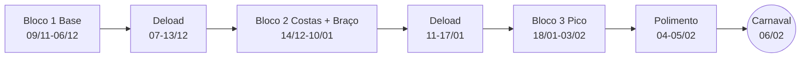

# Plano até o Carnaval — Vinicius Siqueira (Superior, 6x/semana)

## Resumo Didático

**O que é:** o plano de treino do Vinicius de 09/11/2026 até o Carnaval (06/02/2027), dividido em 3 blocos com deloads entre eles, para chegar ao Carnaval com os músculos do tronco e braços no melhor ponto.

**Como funciona:**
- **Bloco 1 (Base):** calibra as cargas e acumula volume em tudo (já está no app).
- **Bloco 2 (Especialização):** costas e braço ganham muito volume; peito e ombro ficam em manutenção (o mínimo para não perder).
- **Bloco 3 (Pico):** repetições mais altas e técnicas como drop set (tirar peso e continuar sem descanso), para o músculo ficar cheio e marcado.
- **Polimento (04–05/02):** treinos leves para chegar descansado e "inchado" no Carnaval, não destruído.
- **Deload** (semana leve: metade das séries, menos carga) entre os blocos, para o corpo recuperar e voltar a responder.

**Diagrama:**

**Por que assim:** com FFMI ~25 (perto do teto natural), o ganho vem de variar o tipo de estímulo e gerir a fadiga; o visual do Carnaval depende muito mais de perder gordura do que de ganhar músculo em 13 semanas. Descartada a opção de um único bloco longo até o Carnaval: sem deloads, a fadiga acumulada derruba o rendimento justamente na reta final.

---

## 1. Perfil e premissas
- 36 anos · 1,68 m · 84 kg · BF 15% → ~71 kg de massa magra · FFMI ~25 · treina desde os 16 · sem lesões · academia completa.
- Treina Seg–Sáb, **sem treino de perna** (escolha do aluno). Corrida leve 30 min 3x/semana por conta própria.
- Treina nas festas (25/12 e 01/01 caem na sexta: se a academia fechar, pule o treino E daquela semana).
- Prioridades: **costas e braço**.

## 2. Regras fixas (todo o plano)
- **Âncoras** (mesmo exercício até o Carnaval, carga anotada toda semana): Supino Reto com Barra (A), Barra Fixa Pronada (B), Remada Curvada com Barra (B), Desenvolvimento Militar com Barra (F).
- **Compostos em pirâmide curta** (suba a carga a cada série, todas a 1–2 reps da falha). **Isolados e máquinas em dupla progressão** (mesma carga; fechou o topo da faixa em todas as séries, sobe ~2–5%).
- Última série de cada exercício a 0–1 rep da falha. Descida em 2–3s, amplitude completa, ênfase no alongamento.
- Descanso: ≥2' nos compostos livres; 1'–1'30" nos isolados (Bloco 3: 45"–1' nos isolados).
- Máximo ~10 séries por músculo por sessão.
- Divisão fixa: A Seg Push 1 · B Ter Pull 1 · C Qua Ombros + Braços 1 · D Qui Push 2 · E Sex Pull 2 · F Sáb Ombros + Braços 2. Cada músculo 2x+/semana.
- Exercícios removidos a pedido do aluno (não usar): Paralelas (Mergulho) e Remada T (Cavalinho).

## 3. Cronograma

| Bloco | Datas | Reps nos compostos | Reps nos isolados | Técnicas | Ficha |
|---|---|---|---|---|---|
| 1. Base | 09/11 → 06/12/2026 | 10-8-6(-6) | 8-15 | Drop set só na elevação lateral | `Treinos/Vinicius/treino-09-11-2026.md` |
| Deload | 07/12 → 13/12 | — | — | Metade das séries, −20–30% carga | (usa a ficha do Bloco 2, publicada em 07/12) |
| 2. Especialização Costas + Braço | 14/12/2026 → 10/01/2027 | 10-8-6 | 10-15 | Rosca e tríceps no alongamento; rest-pause na última série de 1 exercício de bíceps e 1 de tríceps | `Treinos/Vinicius/treino-14-12-2026.md` |
| Deload | 11/01 → 17/01/2027 | — | — | Metade das séries, −20–30% carga | (usa a ficha do Bloco 3, publicada em 11/01) |
| 3. Pico | 18/01 → 03/02/2027 | 12-10-8 | 12-20 | Drop set e rest-pause na última série dos isolados; descanso curto | `Treinos/Vinicius/treino-18-01-2027.md` |
| Polimento | Qui 04/02 e Sex 05/02 | — | — | Treinos D e E com metade das séries, 2–3 reps sobrando, foco no pump | (seção na ficha do Bloco 3) |
| Carnaval | 06/02 → 09/02/2027 | — | — | Descanso | — |

Progressão dentro do bloco: **semanas 3–4** do Bloco 2 e **semana 3** (01–03/02) do Bloco 3 ganham +1 série nos exercícios marcados.

## 4. Volume por bloco (séries diretas/semana, início → fim)

| Músculo | Bloco 1 | Bloco 2 (especialização) | Bloco 3 (pico) |
|---|---|---|---|
| Costas | 20 | 22 → 25 | 18 → 20 |
| Bíceps | 15 → 16 | 18 → 20 | 14 → 16 |
| Tríceps | 15 → 16 | 18 → 20 | 14 → 16 |
| Peito | 20 | 10 (manutenção) | 16 → 18 |
| Deltoide lateral | 13 → 15 | 10 (manutenção) | 14 → 16 |
| Deltoide posterior | 9 | 6 | 9 |
| Trapézio | 3 | 3 | 3 |
| Abdômen | 6 | 6 | 6 |

Margem de ±1 série. **Se estiver em déficit calórico** (seção 7), use o início da faixa do Bloco 2 (costas 22, braços 18) sem subir.

## 5. Monitoramento
- **Medir** nos dias 09/11, 14/12, 18/01 e 04/02, sempre de manhã, em jejum: peso, circunferência do braço contraído e relaxado (parte mais grossa), peito (linha dos mamilos), cintura (umbigo), fotos de frente, lado e costas, cargas dos 4 âncoras.
- **Antecipe o deload** se por 2 semanas seguidas as âncoras caírem, o sono piorar ou aparecer dor articular que não some em 48h.

## 6. Depois do Carnaval
- Semana 10–14/02: retorno leve (como um deload). A partir de 15/02, montar o próximo ciclo (força-hipertrofia ou nova especialização) com base nas medidas de 04/02.

## 7. Alimentação (recomendação, opcional) — cap. 9
- O visual do Carnaval vem principalmente de **perder gordura**. Meta sugerida: ~0,5 kg/semana (84 → ~78 kg, BF 15% → ~11–12%).
- **Déficit** de ~400–500 kcal/dia abaixo da manutenção. Se o peso cair mais de 1 kg/semana, coma mais.
- **Proteína ~2,2 g/kg/dia (~185 g)**, em 4+ refeições de ~40–45 g; uma antes e outra depois do treino.
- **Carboidrato** concentrado em torno do treino; gordura ≥ ~0,8–1 g/kg.
- Sem déficit (manutenção ou superávit leve), o treino é o mesmo, mas a diferença visual no Carnaval será bem menor.

## 8. Automação
- **07/12 (Seg) 07:30:** monta o Bloco 2 (rotina `rotinas/rotina-montar-bloco-vinicius.md`), publica e manda resumo no WhatsApp.
- **11/01 (Seg) 07:30:** monta o Bloco 3 (inclui o polimento), publica e manda resumo.
- Lembretes no WhatsApp às 08:30 em 09/11, 14/12, 18/01 e 04/02 (início do bloco e medição).

## 9. Registro da automação
(As rotinas acrescentam uma linha aqui a cada bloco montado.)
